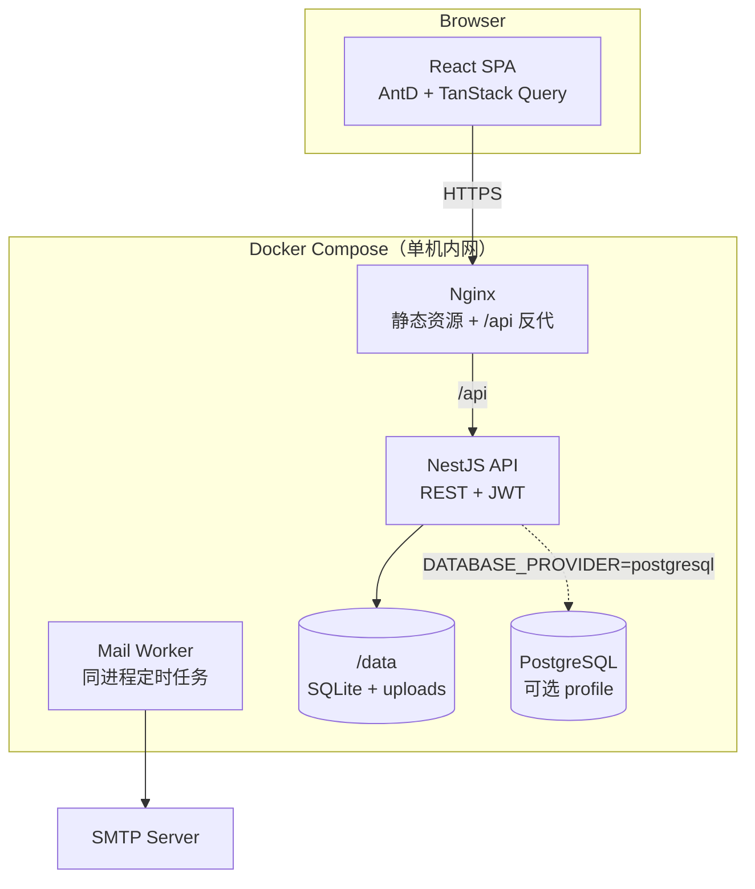
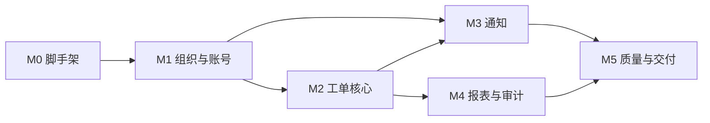

# 运维工单系统（TicketReport）实施计划

| 项目 | 内容 |
| --- | --- |
| 文档版本 | v0.3（已实施） |
| 日期 | 2026-11-25 |
| 关联文档 | [需求文档](./requirements.md) |
| 说明 | 评审结论：Q1=B，其余按默认方案；已按 M0→M5 完成第一版实现，可本地与 Docker 启动；v0.3 增补内部工单 / 代客提单 / 运维角色调整 |

---

## 1. 技术选型与关键决策

| 层 | 选型 | 说明 |
| --- | --- | --- |
| 前端 | React 18 + TypeScript + Vite | 构建快、内网离线可打包 |
| UI | Ant Design 5 | 后台表格/表单/筛选密集，组件完备；图标与字体本地打包，不依赖 CDN |
| 前端状态 | TanStack Query（服务端状态）+ Zustand（登录态/UI 状态） | 避免把服务端数据塞进全局 store |
| 路由 | React Router 6 | 路由级权限守卫 |
| 图表 | ECharts（`echarts-for-react`） | 报表分布图，离线可用 |
| 后端 | Node 20 + NestJS 10 + TypeScript | 模块化、守卫/拦截器机制适合做权限与审计切面 |
| ORM | Prisma 5 | 类型安全；通过双 schema 支持 SQLite / PostgreSQL |
| 校验 | zod + 共享 schema 包 | 前后端共用入参校验与枚举定义 |
| 认证 | JWT Access（内存，15min）+ Refresh（httpOnly Cookie，7d，轮换） | 减少 XSS 窃取长令牌风险 |
| 密码 | scrypt（Node 内置 `crypto`，避免 Windows 原生编译）；如需更高强度可后续切换 argon2id | 与需求文档「bcrypt/argon2」目标等价：均为慢哈希 + 随机盐 |
| 邮件 | Nodemailer | 通过 `SMTP_*` 环境变量配置 |
| 文件 | Multer + 本地卷 | `/data/uploads`，Nginx 不直接暴露 |
| 测试 | Vitest（单元）、Supertest（接口）、Playwright（E2E） | |
| 部署 | Docker Compose（web + api + 可选 postgres） | Nginx 托管静态资源并反代 `/api` |
| 包管理 | npm workspaces 单仓多包 | 目标环境未安装 pnpm；npm 11 自带 workspaces，行为一致 |

### 1.1 关键决策记录

**D1：为什么用 Prisma 双 schema 而不是运行时切换 provider**

Prisma 的 `datasource.provider` 是编译期常量，无法用环境变量切换。方案：

- `prisma/schema.sqlite.prisma` 与 `prisma/schema.postgresql.prisma` 两个文件，模型定义完全一致，仅 `datasource` 与少数字段类型不同；
- `scripts/check-schema-parity.mjs` 在 CI 中比对两个文件的 model 块（忽略 datasource 段），不一致则失败，防止漂移；
- 迁移目录分离：`prisma/migrations/sqlite/*`、`prisma/migrations/postgresql/*`；
- `prisma generate --schema <选中的 schema>`，业务代码只 import 生成的 client，不感知 provider；
- 切换 PostgreSQL：改 `DATABASE_PROVIDER=postgresql` + `DATABASE_URL`，执行 `npm run db:generate && npm run db:migrate:deploy`。

**D2：SQLite 兼容性约束（写进编码规范，避免切换时返工）**

| 约束 | 原因 | 落地方式 |
| --- | --- | --- |
| 不使用数据库原生枚举 | SQLite 不支持 enum | 库内存 `String`，TS 层用 `as const` 联合类型 + zod 校验 |
| `Json` 字段存 `TEXT` | 两类数据库 Json 行为有差异 | 统一 `serializeJson/parseJson` 工具，字段命名 `*_json` |
| 不使用数组字段 | SQLite 不支持标量数组 | 多值关系用关联表 |
| 不使用部分索引 / 表达式索引 | SQLite 与 PG 语法差异 | 只用普通复合索引 |
| 不区分大小写搜索 | Prisma 的 `mode: 'insensitive'` 仅 PG 支持 | 仓储层封装：PG 走 `mode: 'insensitive'`，SQLite 走 `contains`（ASCII 大小写不敏感） |
| 单写连接 | SQLite 并发写弱 | 开启 WAL；写事务短小；部署单实例 api（如需横向扩展必须切 PG） |

**D3：状态机集中定义，前后端同源**

在 `packages/shared` 中导出：

```ts
export const TICKET_STATUS = {
  PENDING: 'PENDING',
  PROCESSING: 'PROCESSING',
  PENDING_CONFIRM: 'PENDING_CONFIRM',
  CLOSED: 'CLOSED',
  CANCELLED: 'CANCELLED',
} as const;

export const TRANSITIONS = [
  { action: 'CLAIM', from: ['PENDING'], to: 'PROCESSING', roles: ['AGENT'] },
  { action: 'ASSIGN', from: ['PENDING', 'PROCESSING'], to: 'PROCESSING', roles: ['OPS_LEAD', 'ADMIN'] },
  { action: 'RESOLVE', from: ['PROCESSING'], to: 'PENDING_CONFIRM', roles: ['AGENT', 'OPS_LEAD', 'ADMIN'] },
  { action: 'CONFIRM', from: ['PENDING_CONFIRM'], to: 'CLOSED', roles: ['REPORTER'] },
  { action: 'REJECT', from: ['PENDING_CONFIRM'], to: 'PROCESSING', roles: ['REPORTER'] },
  { action: 'FORCE_CLOSE', from: ['PROCESSING', 'PENDING_CONFIRM'], to: 'CLOSED', roles: ['OPS_LEAD', 'ADMIN'] },
  { action: 'REOPEN', from: ['CLOSED'], to: 'PROCESSING', roles: ['REPORTER'] },
  { action: 'CANCEL', from: ['PENDING'], to: 'CANCELLED', roles: ['REPORTER'] }, // Q1 已确认：待受理可撤回
  // 完整定义见 requirements.md 6.2
] as const;
```

后端 `TicketStateMachine.assertCanTransition(ticket, action, actor)` 负责状态 + 角色 + 资源归属三重校验；前端根据同一份 `TRANSITIONS` + 当前用户角色渲染操作按钮。**角色不是唯一条件**（还要求本人/本组），前端只做展示，后端做最终判定。

内部工单补充：

- `TICKET_TYPES = ['CUSTOMER', 'INTERNAL']`；内部工单 `enterpriseId = null`，客户 scope 天然不可见；
- 共享 `availableActions(status, role, { isReporter, isInternal })`：`CONFIRM` / `REJECT` / `REOPEN` / `CANCEL` 属于「提报人动作」，内部工单按 `isReporter` 判定，客户工单仍要求 `REPORTER` 角色且为提报人本人；
- 服务端 `confirm` / `reject` / `reopen` 统一走 `assertReporterAction`：内部工单校验提报人本人；客户工单要求 `role === 'REPORTER'` 且为提报人本人；代客户提单由同企业客户账号执行（代提人不能代替客户确认）；`forceClose` 仍限 `OPS_LEAD` / `ADMIN`。

**D4：通知适配层**

```ts
// packages/shared 或 api/src/notifications/channel.interface.ts
export interface NotificationRecipient {
  userId: string;
  email: string;
  name: string;
  role: UserRole;
}

export interface NotificationEvent {
  type: NotificationType;          // TICKET_ASSIGNED / TICKET_COMMENT ...
  ticket?: TicketSummary;
  actor?: { id: string; name: string };
  payload?: Record<string, unknown>;
  recipients: NotificationRecipient[];
}

export interface NotificationChannel {
  readonly key: 'IN_APP' | 'EMAIL' | 'WECOM';
  send(event: NotificationEvent): Promise<ChannelResult>;
}
```

- `NotificationDispatcher` 注入 `NotificationChannel[]`（NestJS 多 provider 注入口 token `NOTIFICATION_CHANNELS`），逐个调用，单个渠道失败不影响其他渠道；
- 第一阶段注册 `InAppChannel`、`EmailChannel`；
- 后续接企业微信：新增 `WecomChannel` 并在模块中注册，**业务服务代码零改动**；
- 业务侧只调用 `dispatcher.dispatch(event)`，不 import 任何具体渠道。

**D5：邮件 outbox 作为可靠队列**

- 所有邮件先落 `email_outbox`（状态 `PENDING`），再由 `MailWorker`（`@nestjs/schedule`，每 15s 扫描）取出投递；
- SMTP 未配置：直接置 `SKIPPED_NO_SMTP`，并暴露开发态接口 `GET /api/dev/outbox`（仅 `NODE_ENV !== 'production'` 且需管理员登录）便于联调；
- 失败重试 3 次（1/5/15 分钟退避），最终 `FAILED`；
- 邮件正文由模板函数生成（`templates/*.ts` 返回 `{ subject, html, text }`），不引入重型模板引擎。

---

## 2. 架构总览



- api 与 web 分容器，同一 compose 网络；对外只暴露 Nginx 端口；
- 默认 SQLite 文件与附件都在挂载卷 `/data`，容器重建不丢数据；
- 可选 `docker compose --profile postgres up` 启用 PostgreSQL。

---

## 3. 目录结构

```text
TicketReport/
├─ docs/
│  ├─ requirements.md
│  └─ plan.md
├─ apps/
│  ├─ api/
│  │  ├─ prisma/
│  │  │  ├─ schema.sqlite.prisma
│  │  │  ├─ schema.postgresql.prisma
│  │  │  ├─ migrations/sqlite/
│  │  │  └─ migrations/postgresql/
│  │  ├─ src/
│  │  │  ├─ main.ts
│  │  │  ├─ app.module.ts
│  │  │  ├─ common/            # 守卫、过滤器、拦截器、装饰器、分页
│  │  │  ├─ prisma/
│  │  │  ├─ auth/
│  │  │  ├─ users/
│  │  │  ├─ enterprises/
│  │  │  ├─ categories/
│  │  │  ├─ groups/
│  │  │  ├─ tickets/
│  │  │  │  ├─ ticket-state-machine.ts
│  │  │  │  ├─ ticket-access.service.ts   # 资源归属/企业边界校验
│  │  │  │  ├─ tickets.controller.ts
│  │  │  │  └─ tickets.service.ts
│  │  │  ├─ comments/
│  │  │  ├─ attachments/
│  │  │  ├─ notifications/
│  │  │  │  ├─ dispatcher.ts
│  │  │  │  └─ channels/{in-app,email}.channel.ts
│  │  │  ├─ mail/              # outbox + worker + templates
│  │  │  ├─ reports/
│  │  │  ├─ settings/
│  │  │  └─ audit/
│  │  └─ test/                 # 单元 + 集成 + 隔离测试
│  └─ web/
│     ├─ src/
│     │  ├─ app/               # 路由、布局、providers
│     │  ├─ features/{auth,tickets,admin,reports,notifications}/
│     │  ├─ shared/            # api client、hooks、权限指令
│     │  └─ styles/
│     └─ vite.config.ts
├─ packages/
│  └─ shared/                  # 枚举、状态机、zod schema、DTO 类型
├─ scripts/
│  ├─ check-schema-parity.mjs
│  └─ seed.ts
├─ docker/
│  ├─ api.Dockerfile
│  ├─ web.Dockerfile
│  └─ nginx.conf
├─ docker-compose.yml
├─ package.json                # npm workspaces 根配置
└─ README.md                   # 部署与运维说明
```

---

## 4. 后端设计

### 4.1 模块与职责

| 模块 | 职责 | 关键实现点 |
| --- | --- | --- |
| `PrismaModule` | 数据库连接、软删除无关 | `onModuleDestroy` 断开；SQLite 开启 WAL、`busy_timeout` |
| `AuthModule` | 登录、刷新、登出、激活、找回/重置 | 全局 `JwtAuthGuard` + `@Public()` 白名单；`RolesGuard`；`LoginThrottleGuard` |
| `EnterprisesModule` | 客户企业 CRUD、停用 | 停用时事务内禁用其员工 |
| `UsersModule` | 邀请、重发、禁用、改资料 | 邀请令牌哈希入库，旧令牌置失效 |
| `GroupsModule` / `CategoriesModule` | 处理组与分类维护 | 分类删除改为停用；停用组不可再落单 |
| `TicketsModule` | 工单主流程 | 状态机、乐观锁、事务内写事件与通知 |
| `CommentsModule` | 评论、内部备注 | 序列化层按角色过滤 INTERNAL |
| `AttachmentsModule` | 上传/下载 | 类型嗅探（magic number）+ 扩展名双校验；流式下载鉴权 |
| `NotificationsModule` | 事件分发、站内消息 | 渠道注册表；未读数聚合查询 |
| `MailModule` | outbox 入队、worker 投递、模板 | 重试与退避；未配置 SMTP 直接 `SKIPPED_NO_SMTP` |
| `ReportsModule` | 基础统计 | 聚合查询 + 企业/组范围过滤 |
| `SettingsModule` | 参数读写 | 白名单 key，值类型校验 |
| `AuditModule` | 管理操作审计 | 拦截器 + 显式调用结合 |

### 4.2 API 清单

统一前缀 `/api`。错误结构：

```json
{ "code": "TICKET_INVALID_TRANSITION", "message": "当前状态不允许该操作", "details": { "from": "CLOSED", "action": "RESOLVE" }, "traceId": "..." }
```

分页响应：`{ "items": [], "total": 0, "page": 1, "pageSize": 20 }`

#### 认证

| 方法 | 路径 | 权限 | 说明 |
| --- | --- | --- | --- |
| POST | `/auth/login` | 公开 | 邮箱+密码，返回 access token 并 Set-Cookie refresh |
| POST | `/auth/refresh` | 公开（凭 Cookie） | 轮换 refresh，返回新 access |
| POST | `/auth/logout` | 登录 | 撤销 refresh |
| POST | `/auth/activate` | 公开（凭令牌） | 邀请链接设置密码并激活 |
| POST | `/auth/forgot-password` | 公开 | 发送重置邮件 |
| POST | `/auth/reset-password` | 公开（凭令牌） | 重置密码、置「待改密」、递增 `tokenVersion` 并失效全部会话 |
| GET | `/auth/me` | 登录 | 当前用户、角色、企业、`mustChangePassword` |
| PATCH | `/auth/me/password` | 登录 | 修改密码（校验原密码，成功后清除待改密标记并失效旧令牌） |

> 强制改密：`AuthGuard` 发现自己加载的 `user.mustChangePassword = true` 时，仅放行 `GET /auth/me`、`PATCH /auth/me/password`、`POST /auth/logout`，其余接口统一返回 `403 { code: 'PASSWORD_CHANGE_REQUIRED' }`；同时比较 JWT 内 `ver` 与数据库 `tokenVersion`，不一致即 `401`（重置/改密后旧访问令牌立即失效）。

#### 管理端

| 方法 | 路径 | 权限 | 说明 |
| --- | --- | --- | --- |
| GET/POST | `/admin/enterprises` | ADMIN | 列表（含工单数）/ 创建 |
| GET/PATCH | `/admin/enterprises/:id` | ADMIN | 详情 / 编辑 / 停用 |
| GET | `/admin/enterprises/:id/users` | ADMIN | 企业员工列表 |
| POST | `/admin/users/invite` | ADMIN | 邀请客户员工或创建运维账号 |
| POST | `/admin/users/:id/resend-invite` | ADMIN | 重发邀请 |
| POST | `/admin/users/:id/reset-password` | ADMIN | 重置为默认密码 `Passw0rd!`，置「待改密」，失效全部令牌，写 `USER_PASSWORD_RESET` 审计 |
| PATCH | `/admin/users/:id` | ADMIN | 改名/改手机/禁用/启用/改角色（仅运维侧，写 `USER_ROLE_CHANGE` 审计，立即生效） |
| GET/POST | `/admin/categories` · PATCH `/admin/categories/:id` | ADMIN | 分类维护 |
| GET/POST | `/admin/groups` · PATCH `/admin/groups/:id` | ADMIN | 处理组维护 |
| PUT | `/admin/groups/:id/members` | ADMIN | 覆盖式设置成员 |
| GET/PATCH | `/admin/settings` | ADMIN | 系统参数 |
| GET | `/admin/audit-logs` | ADMIN | 审计日志查询 |

#### 工单

| 方法 | 路径 | 权限 | 说明 |
| --- | --- | --- | --- |
| GET | `/tickets` | 登录 | 按角色自动限定范围；筛选、分页 |
| POST | `/tickets` | 登录 | 创建（客户提单 / 内部工单 / 代客户提单；描述为富文本 HTML，服务端清洗并按其纯文本校验字数；自动落组、发通知） |
| GET | `/tickets/:id` | 登录 | 详情（含客户侧过滤后的时间线与评论） |
| PATCH | `/tickets/:id` | 提报人本人（PENDING） | 编辑主信息（不可改工单类型 / 企业归属）；描述同样按富文本清洗与纯文本字数校验，用于提单后回填图片附件引用 |
| POST | `/tickets/:id/claim` | AGENT | 认领 |
| POST | `/tickets/:id/assign` | OPS_LEAD/ADMIN | `{ groupId, assigneeId?, reason }` |
| POST | `/tickets/:id/transfer` | AGENT(本人)/OPS_LEAD/ADMIN | `{ groupId, assigneeId?, reason }` |
| POST | `/tickets/:id/release` | OPS_LEAD/ADMIN | 撤回认领 |
| POST | `/tickets/:id/resolve` | 当前处理人/主管/管理员 | `{ resolution, attachmentIds? }` |
| POST | `/tickets/:id/confirm` | 提报人本人（客户工单需 REPORTER） | 确认关闭 |
| POST | `/tickets/:id/reject` | 提报人本人（客户工单需 REPORTER） | `{ reason }` 反馈未解决 |
| POST | `/tickets/:id/force-close` | OPS_LEAD/ADMIN | `{ reason }` |
| POST | `/tickets/:id/reopen` | 提报人本人（客户工单需 REPORTER） | 校验时限 |
| POST | `/tickets/:id/cancel` | 提报人本人（PENDING） | `{ reason? }` 撤回，终态「已取消」 |
| GET | `/tickets/:id/events` | 登录 | 时间线（客户侧过滤） |
| POST | `/tickets/:id/comments` | 登录 | `{ content, visibility, attachmentIds? }`；`content` 为富文本 HTML，服务端清洗后入库，通知/邮件使用纯文本降级 |
| DELETE | `/comments/:id` | 作者（10 分钟内） | 撤回 |
| POST | `/tickets/:id/attachments` | 登录 | multipart 上传 |
| GET | `/attachments/:id/download` | 登录（边界校验） | 流式下载 |

#### 通知 / 报表 / 开发态

| 方法 | 路径 | 权限 | 说明 |
| --- | --- | --- | --- |
| GET | `/notifications` | 登录 | 消息列表（可按未读筛选） |
| GET | `/notifications/unread-count` | 登录 | 未读数轮询（30s） |
| POST | `/notifications/:id/read` · `/notifications/read-all` | 登录 | 已读 |
| GET | `/reports/overview` | 登录 | 概览指标 + 分布 |
| GET | `/reports/workload` | AGENT/OPS_LEAD/ADMIN | 处理人工作量 |
| GET | `/dev/outbox` | ADMIN（非生产） | 联调查看本地邮件 |

### 4.3 权限与隔离实现

1. **认证守卫**：全局 `JwtAuthGuard`，`@Public()` 放行登录/激活/重置。
2. **角色守卫**：`@Roles(...)` 元数据 + `RolesGuard`；方法级覆盖类级。
3. **租户范围**：`TicketsService` 不暴露无过滤的查询，统一经 `buildTicketScope(user)`：
   - `REPORTER` → `{ enterpriseId: user.enterpriseId }`（内部工单 `enterpriseId = null` 天然不可见）
   - `AGENT` → `{ OR: [{ groupId: { in: userGroupIds } }, { assigneeId: user.id }, { events: { some: { actorId: user.id } } }] }`
   - `OPS_LEAD` / `ADMIN` → `{}`（全部）
4. **单资源校验**：`TicketAccessService.assertCanRead/assertCanOperate`，客户侧不匹配企业时抛 `NotFoundException`（404），避免探测。
5. **序列化过滤**：`toTicketDetail(ticket, viewer)` 中根据 `viewer.role` 剔除 `INTERNAL` 评论、内部事件字段、`assignee` 邮箱等；过滤在服务端返回前完成。
6. **防止绕过**：附件下载、报表查询、通知跳转均复用同一 `TicketAccessService`，不允许各模块各写一套判断。
7. **测试**：`test/isolation.e2e-spec.ts` 用两个企业 + 运维账号，覆盖 12 条越权路径（详见 8.2）。

### 4.4 工单流转事务

```ts
await prisma.$transaction(async (tx) => {
  const updated = await tx.ticket.updateMany({
    where: { id, version: current.version, status: { in: fromStates } },
    data: { status: to, assigneeId, groupId, version: { increment: 1 }, lastActivityAt: new Date() },
  });
  if (updated.count === 0) throw new ConflictException('工单状态已变更，请刷新');
  await tx.ticketEvent.create({ data: eventData });
  await tx.ticketComment.create({ data: commentData }); // 处理结果/原因
  const notifications = await tx.notification.createMany({ data: rows });
  await tx.emailOutbox.createMany({ data: mails });
});
// 事务提交后再触发渠道投递（邮件由 worker 扫描，站内消息已入库）
```

- 通知落库在事务内，实际邮件投递由 worker 异步执行，保证「业务成功 = 通知不丢」；
- 事务内不做网络 IO。

### 4.5 附件安全

- Multer `memoryStorage` → 校验大小/类型 → 随机文件名（`crypto.randomUUID()`）→ 写入 `/data/uploads/{enterpriseId}/{ticketId}/{uuid}.{ext}`（运维附件用 `_ops` 目录避免泄漏企业归属）；
- 类型校验取扩展名白名单 + magic number 比对（`file-type`），不信任 `Content-Type`；
- 下载：校验登录 → 校验工单可见性 → `res.sendFile` 绝对路径（路径由入库的 `stored_path` 拼接并做 `path.resolve` 前缀校验，防目录穿越）；
- Nginx 不直接映射 uploads 目录。

### 4.6 富文本与内嵌图片

- **存储**：`Ticket.description`、`TicketComment.content` 存清洗后的 HTML；`apps/api/src/common/rich-text.ts` 用 `sanitize-html` 白名单（`p/br/strong/b/em/i/u/s/ul/ol/li/h1-h4/blockquote/code/pre/a/img/hr`），链接只留 `href/rel` 并强制补 `rel="noopener noreferrer"`，图片只留 `src/alt/title/width/height/data-attachment-id/data-pending-image`，协议仅 `http/https/mailto`；无有效来源（非 `http(s)://`、非附件下载地址且无占位标记）的 `img` 直接丢弃。历史纯文本数据在读取出口 `ticket.mapper.ts` 再清洗一次。
- **长度**：zod 仅限制原始字符串 ≤20000；服务层用 `richTextToPlainText` 计算纯文本长度（描述 10–5000、评论 1–5000），避免 HTML 标签撑大内容。
- **评论与通知**：`ticketComment` 等邮件模板使用清洗后的纯文本 `content.text`（保留段落换行），HTML 模板对文本做 `escapeHtml`，纯文本客户端得到合理降级。
- **内嵌图片**：粘贴/上传的图片一律走 `/tickets/:id/attachments` 存为工单附件，正文写 ``；下载接口沿用现有登录态 + 工单可见性校验（客户只能看本企业工单附件）。前端 `api.blob()` 带 access token 拉取后转 objectURL 展示，避免 token 过期或公开直链。
- **提单时序**：工单尚不存在时，正文图片先写 `` 占位；`POST /tickets` 成功后按序上传占位图片，再用 `PATCH /tickets/:id` 回填真实 `src` 与 `data-attachment-id`，失败的图片提示用户。
- **前端组件**：`RichTextEditor`（Tiptap v3 + StarterKit + Image）负责编辑与 `paste/drop` 图片拦截；`RichTextView` 负责只读渲染并水合附件图片；样式沿用 AntD 表单风格。

---

## 5. 前端设计

### 5.1 页面与路由

| 路由 | 页面 | 权限 |
| --- | --- | --- |
| `/login` | 登录 | 公开 |
| `/activate?token=` | 设置密码激活 | 公开 |
| `/forgot-password` · `/reset-password?token=` | 找回/重置 | 公开 |
| `/change-password` | 修改密码（首次登录强制改密复用此页） | 登录 |
| `/tickets` | 工单列表（客户/运维两种视图形态） | 登录 |
| `/tickets/new` | 提交工单（运维侧增加「内部工单 / 代客户提单 + 企业选择」） | 登录 |
| `/tickets/:id` | 工单详情（时间线 + 评论区 + 操作区） | 登录 |
| `/notifications` | 消息中心 | 登录 |
| `/reports` | 基础报表 | 登录（数据范围受限） |
| `/admin/enterprises` · `/admin/enterprises/:id` | 客户企业管理 | ADMIN |
| `/admin/users` | 账号管理 | ADMIN |
| `/admin/categories` · `/admin/groups` | 分类与处理组 | ADMIN |
| `/admin/settings` · `/admin/audit-logs` | 系统设置、审计 | ADMIN |

### 5.2 关键交互

- **工单详情操作区**由 `getAvailableActions(ticket, user)`（共享包内实现，与服务端同一份 `TRANSITIONS`）驱动，按钮点击后弹窗收集必填项（原因 / 处理说明）；
- **内部备注**：编辑框顶部 Tab 切换「回复客户 / 内部备注」，内部备注用黄色底 + `仅内部可见` 标签；
- **状态时间线**：客户侧与运维侧使用同一组件，数据源为服务端已过滤的 `events`；
- **未读提醒**：`useUnreadCount` 每 30s 轮询（第一阶段不引入 WebSocket），页面标题同步未读数；
- **强制改密**：登录响应 `user.mustChangePassword` 为真时直接进入 `/change-password`；`RequireAuth` 与 `apiClient` 在收到 403 `PASSWORD_CHANGE_REQUIRED` 时统一跳转该页，改密成功后清理登录态并要求用新密码重新登录；
- **表单校验**：`packages/shared` 的 zod schema，前端即时提示、后端强校验；
- **列表**：服务端分页 + URL 同步筛选条件（可分享/刷新保持）。

### 5.3 状态与请求

- `apiClient`：fetch 封装，自动附带 access token；401 时用 refresh 换新 token 并重放一次请求，失败则跳登录；
- TanStack Query key 规划：`['tickets', filters]`、`['ticket', id]`、`['notifications', filters]`、`['unread-count']`；写操作成功后在 `onSuccess` 精准失效；
- 不在前端做权限判断的「唯一防线」，所有隐藏仅用于体验。

### 5.4 富文本编辑与图片

- `apps/web/src/components/RichTextEditor.tsx`：Tiptap v3（`StarterKit` + 自定义 `AttachmentImage`），工具栏覆盖加粗/斜体/下划线/删除线/标题/列表/引用/代码/链接/撤销重做；`handlePaste` / `handleDrop` 拦截图片文件，调用 `uploadImage(file)` 后插入预览；
- `apps/web/src/components/RichTextView.tsx`：`dangerouslySetInnerHTML` 渲染服务端已清洗的 HTML，并 `hydrateAttachmentImages` 按 `data-attachment-id` 用 `api.blob()` 拉取图片替换为 objectURL，组件卸载时释放；
- 提单页与详情页（编辑弹窗、评论框）统一使用该编辑器；表单校验按 `richTextToPlainText` 计算纯文本长度，与服务端一致；
- `apps/web/src/lib/rich-text.ts` 负责编辑态 HTML 归一化：`data-attachment-id` 强制使用附件下载地址；无来源的 `blob:` 预览在提交前去掉。

### 5.5 开发态共享包解析（白屏修复）

- **现象**：提交工单后页面空白，从列表点开工单详情同样白屏；列表页正常。
- **根因**：`apps/web/node_modules/@ticketreport/shared` 是构建产物副本，Vite 预构建缓存 `node_modules/.vite/deps/@ticketreport_shared.js` 在共享包新增导出（`canEditWorkHours`）后未失效，详情页调用到 `undefined` 抛 `TypeError`，React 渲染异常导致整棵组件树卸载，只剩空白页；列表页未使用该导出所以不受影响。
- **修复**：`apps/web/vite.config.ts` 增加 `resolve.alias`，把 `@ticketreport/shared` 直接指向 `packages/shared/src/index.ts`，并用 `server.fs.allow` 放开仓库根目录；开发态从此读取源码，不再依赖 node_modules 副本与预构建缓存，新增共享导出即时生效。生产构建仍走构建产物。
- **排查结论**：全站仅 `TicketDetailPage` 使用 `canEditWorkHours`，其余页面只使用未变化的枚举与状态机函数，无第二处同类崩溃。

---

## 6. 分阶段任务拆解

> 工作量标记：S（1 单元以内）、M（1–2 单元）、L（需要拆分并行）。阶段间为强依赖，阶段内任务可并行。

### M0 工程脚手架（S）

| 任务 | 产出 | 完成标准 |
| --- | --- | --- |
| M0-1 npm workspaces + TS/lint/prettier 配置 | 根配置、`packages/shared` 骨架 | `npm run lint`、`npm run typecheck` 通过 |
| M0-2 NestJS 骨架 + 健康检查 | `apps/api`，`GET /api/health` | 本地启动返回 ok |
| M0-3 Vite + React + AntD 骨架 | `apps/web`，登录页占位 | 本地可访问 |
| M0-4 Prisma 双 schema + 生成/迁移脚本 + parity 校验 | `prisma/*`、`scripts/check-schema-parity.mjs` | SQLite 建库成功；parity 脚本通过 |
| M0-5 Docker Compose 骨架（nginx + api + 卷） | `docker/`、`docker-compose.yml` | 一条命令启动并访问健康检查 |
| M0-6 共享枚举/状态机/DTO 定义 | `packages/shared/src` | 前后端均可引用，类型编译通过 |

### M1 组织、账号与隔离基座（M）

| 任务 | 产出 | 完成标准 |
| --- | --- | --- |
| M1-1 企业 CRUD 与停用 | enterprises 模块、管理页 | 对应 AC-ORG-01/02/04 |
| M1-2 邀请与激活（令牌、邮件模板） | users 模块、auth activate | 邀请邮件可查（outbox），激活可登录 |
| M1-3 登录/刷新/登出、找回与重置密码 | auth 模块、登录/重置页 | AC-AUTH-01/02/03 |
| M1-3a 密码重置与强制改密 | `POST /admin/users/:id/reset-password`、`AuthGuard` 强制改密拦截、`tokenVersion` 令牌失效、`/change-password` 页面、账号管理「重置密码」按钮 | AC-AUTH-04/05/06/07 |
| M1-4 处理组、分类维护 | groups/categories 模块与页面 | 分类必须绑定启用状态的组 |
| M1-5 租户范围与访问校验基建 | `buildTicketScope`、`TicketAccessService`、`RolesGuard` | 单元测试覆盖各角色 scope |
| M1-6 隔离测试骨架 | `test/isolation.e2e-spec.ts` | 至少 4 条越权用例先跑通 |

### M2 工单核心闭环（L）

| 任务 | 产出 | 完成标准 |
| --- | --- | --- |
| M2-1 工单创建（编号生成、自动落组） | tickets service/controller、提交页 | AC-FLOW-01 |
| M2-2 列表与详情（角色视图、筛选、分页） | 列表页、详情页 | 客户/运维视图差异正确 |
| M2-3 状态机 + 认领/指派/转派/撤回 | state-machine、操作弹窗 | AC-FLOW-02/03，并发仅一人认领成功 |
| M2-4 处理结果、确认、拒绝、强制关闭、重开、撤回 | 流转接口与操作区 | AC-FLOW-04～08 与 AC-FLOW-09/10，非法流转返回 409 |
| M2-5 评论与内部备注（含撤回） | comments 模块、评论区组件 | AC-CMT-01/02 |
| M2-6 附件上传/下载与类型校验 | attachments 模块、上传组件 | AC-FILE-01/02/03 |
| M2-7 工单操作日志与时间线 | ticket_event、时间线组件 | 客户侧仅见公开节点 |

### M3 通知与消息中心（M）

| 任务 | 产出 | 完成标准 |
| --- | --- | --- |
| M3-1 通知适配层与渠道注册 | dispatcher + `NOTIFICATION_CHANNELS` | 新增渠道不改业务代码（AC-NOTIFY-05） |
| M3-2 站内消息渠道 + 消息中心 + 未读轮询 | in-app channel、页面、导航红点 | AC-NOTIFY-04 |
| M3-3 outbox 与 MailWorker（含未配置 SMTP 分支、重试） | mail 模块、worker | AC-NOTIFY-01/02/03 |
| M3-4 各业务事件接入通知（提交/受理/评论/待确认/关闭/重开/邀请/重置） | 事件到模板映射 | 全链路手工验证 + 用例 |
| M3-5 邮件模板集中管理与本地化样式 | `mail/templates` | 邮件在 outbox 中可读，样式正常 |

### M4 报表、设置与审计（M）

| 任务 | 产出 | 完成标准 |
| --- | --- | --- |
| M4-1 概览指标与分布图 | reports 模块、报表页 | AC-RPT-01/02 |
| M4-2 处理人工作量统计 | 聚合查询、表格 | 与数据库核对一致 |
| M4-3 系统参数设置与校验 | settings 模块、设置页 | 重开时限等生效 |
| M4-4 管理操作审计日志与查询页 | audit 模块、页面 | 关键管理动作全覆盖 |

### M5 质量与交付（M）

| 任务 | 产出 | 完成标准 |
| --- | --- | --- |
| M5-1 主流程 E2E（Playwright） | `apps/web/e2e/` | 邀请→提交→认领→处理→确认→关闭→重开 全通 |
| M5-2 隔离与权限测试补全 | 接口测试集 | AC-ISO-01～04 |
| M5-3 演示种子数据 | `scripts/seed.ts` | 一键生成 2 企业 / 3 组 / 20 工单 |
| M5-4 PostgreSQL 切换验证 | 迁移脚本、验证记录 | AC-DEPLOY-02 |
| M5-5 README（部署、备份、SMTP 配置、常见问题） | `README.md` | 新机器照文档可完成部署 |
| M5-6 安全与依赖检查 | 检查报告 | 无 high/critical，核心用例通过 |

### M6 内部工单、代客提单与运维角色调整（M，v0.3 增补）

| 任务 | 产出 | 完成标准 |
| --- | --- | --- |
| M6-1 数据模型扩展 | `ticket.ticket_type`（默认 `CUSTOMER`）、`ticket.enterprise_id` 可空、`ticket.on_behalf` | 开发库 `db:push` 平滑升级，历史工单自动为客户工单（AC-FLOW-11） |
| M6-2 提单归属 | `POST /tickets` 支持 `ticketType` / `enterpriseId`；运维侧内部工单与代客提单分支 | 客户账号提交内部工单被拒；代提单未选企业返回 400（AC-FLOW-12/13） |
| M6-3 内部工单流转 | `availableActions` 上下文 + 服务端 `assertReporterAction`；强制关闭留痕 | 提报人本人确认；主管 / 管理员强制关闭并写事件与通知 |
| M6-4 代客提单展示与通知 | 详情 / 列表「内部工单」「代提」标识；企业客户纳入站内通知 | 企业 A 可见、企业 B 不可见；提报人显示为代提人 |
| M6-5 运维角色调整 | `PATCH /admin/users/:id` 支持 `role`；客户账号转换拦截；`USER_ROLE_CHANGE` 审计 | 升降级后下一次请求权限立即变化（AC-ORG-05/06） |
| M6-6 前端适配 | 提交页归属选择、详情动作上下文、账号管理角色下拉 | 处理人 / 主管 / 管理员菜单与按钮正确 |

### M7 领取 / 关闭来源 / 收藏 / 关联（M，v0.4 增补）

| 任务 | 产出 | 完成标准 |
| --- | --- | --- |
| M7-1 数据模型扩展 | `Ticket.closeSource` 可空列；新表 `TicketFavorite`、`TicketRelation`（双 schema 同步） | `npm run db:push` 增量升级成功，历史库无需重建 |
| M7-2 领取与跨组追溯 | `POST /tickets/:id/claim` 放开组限制；`updateMany` 条件更新防并发；跨组写 `CLAIM_CROSS` 事件并记录原处理组；处理人可见范围增加「未认领待受理工单」 | 跨组领取成功且时间线可追溯；客户领取 403；并发仅一人成功（AC-CLAIM-01~03） |
| M7-3 关闭扩展与来源 | `POST /tickets/:id/close`（待确认阶段处理人关闭）；确认 / 关闭 / 强制关闭分别写 `closeSource`；`/reports/overview` 返回 `byCloseSource` | 三类来源分列统计正确；非当前处理人 403；非待确认阶段 409（AC-CLOSE-01~03） |
| M7-4 收藏 | `POST/DELETE /tickets/:id/favorite`；列表 `favorite=1` 筛选与 `favorited` 注入 | 个人级隔离，他人视图不受影响（AC-FAV-01/02） |
| M7-5 关联与可见性 | `GET/POST /tickets/:id/relations`、`DELETE /tickets/:id/relations/:relationId`；ID 归一化 + 唯一约束；读取按 `ticketScope` 过滤，读写双端越权 404 | 双向展示 / 解除 / 409；客户跨企业关联 404 且列表被过滤（AC-REL-01/02） |
| M7-6 前端适配 | 详情页「领取工单」按钮与跨组提示、收藏按钮、关联卡片与搜索弹窗、关闭操作；列表星标 / 高亮 / 「只看我收藏」；报表「关闭来源」卡片 | 构建通过，交互与状态提示正确 |

接口清单（v0.4 新增）：

| 方法 | 路径 | 权限 | 说明 |
| --- | --- | --- | --- |
| POST | `/tickets/:id/claim` | AGENT / OPS_LEAD / ADMIN | 领取待受理且未认领工单，跨组领取写 `CLAIM_CROSS` |
| POST | `/tickets/:id/close` | AGENT（本人处理）/ OPS_LEAD / ADMIN | 待确认阶段关闭，`closeSource=ASSIGNEE_CLOSED` |
| POST / DELETE | `/tickets/:id/favorite` | 有权查看该工单的用户 | 收藏 / 取消收藏（个人级） |
| GET / POST | `/tickets/:id/relations` | 有权查看该工单的用户 | 查询 / 添加关联（双方可见才展示，越权 404） |
| DELETE | `/tickets/:id/relations/:relationId` | 双方均有权查看 | 解除关联 |
| GET | `/reports/overview` | 运维侧 | 新增 `byCloseSource` 分列统计 |

### 后续（第二阶段，不在本次实施）

企业微信渠道实现、SLA 与超时提醒、满意度评价、知识库、分派规则引擎与值班表、报表增强与导出。

### 里程碑依赖



---

## 7. 测试策略

| 层级 | 范围 | 工具 | 关键用例 |
| --- | --- | --- | --- |
| 单元 | 状态机、权限 scope、序列化过滤、模板渲染、编号生成 | Vitest | 全部合法/非法流转组合；各角色 scope 断言 |
| 接口集成 | 认证、工单流转、评论、附件、通知、报表 | Supertest + 测试库（SQLite 内存/临时文件） | 主流程 + 并发认领 + 越权 404 |
| 隔离专项 | 跨企业读写、附件直链、报表、通知、内部工单、代客提单 | Supertest | 12 条越权路径矩阵 + 内部工单客户不可见 + 代提企业隔离 |
| 角色调整 | 运维侧升降级、客户账号转换拦截、审计 | Supertest | AGENT↔OPS_LEAD↔ADMIN 权限即时变化；`USER_ROLE_CHANGE` 落库 |
| 密码重置 | 管理员重置、邮件链接重置、强制改密拦截、令牌失效、待激活账号重置 | Vitest（白名单单测）+ 接口脚本 | 旧访问/刷新令牌立即失效；未改密访问业务接口 403 `PASSWORD_CHANGE_REQUIRED`；改密后恢复；`USER_PASSWORD_RESET` 落库 |
| 富文本 | HTML 白名单清洗、纯文本降级、内嵌图片附件与权限、字数校验、白屏回归 | Vitest + 接口脚本 + 浏览器 | 脚本/事件属性/`javascript:` 被清除；排版与附件图片保留；描述/评论按纯文本校验长度；跨企业下载 404；邮件正文为纯文本；详情页真实浏览器可正常渲染 |
| v0.4 增量 | 跨组领取、关闭来源、收藏隔离、关联越权 | Vitest + 接口脚本 | 跨组 `CLAIM_CROSS` 事件、三类关闭来源计数、收藏个人级隔离、关联重复 409 / 跨企业 404 / 可见性过滤 |
| E2E | 4 个角色的完整闭环 | Playwright | 见 M5-1 |
| 手工验收 | 邮件实际投递、Docker 部署、PG 切换 | 清单 | 对照 requirements.md 第 10 章逐条勾选 |

测试数据原则：每个用例独立建库/清库；不依赖执行顺序；邮件全部走 outbox 断言，不真实外发（除手工验收）。

---

## 8. 部署与运维

### 8.1 环境变量（`.env.example`）

```ini
NODE_ENV=production
PORT=3000
APP_BASE_URL=http://localhost:8080          # 用于邮件内链接
DATABASE_PROVIDER=sqlite                    # sqlite | postgresql
DATABASE_URL=file:/data/app.db
JWT_ACCESS_SECRET=change-me
JWT_REFRESH_SECRET=change-me
ACCESS_TOKEN_TTL=15m
REFRESH_TOKEN_TTL=7d
UPLOAD_DIR=/data/uploads
MAX_ATTACHMENT_MB=20
SMTP_HOST=
SMTP_PORT=465
SMTP_SECURE=true
SMTP_USER=
SMTP_PASSWORD=
SMTP_FROM="运维工单 <no-reply@example.com>"
INITIAL_ADMIN_EMAIL=admin@example.com
INITIAL_ADMIN_PASSWORD=ChangeMe123!
```

### 8.2 启动流程

1. `docker compose up -d --build`；
2. api 容器 entrypoint：等待卷就绪 → `prisma migrate deploy` → 若无管理员则用 `INITIAL_ADMIN_*` 创建 → 启动服务；
3. web 容器 nginx 托管静态资源，`/api` 反代 api；
4. 健康检查：`GET /api/health` 返回 `{ status: 'ok', db: 'ok' }`，compose `depends_on.condition: service_healthy`；
5. 备份：`/data/app.db` + `/data/uploads` 定时打包（README 给出示例脚本与 cron 说明）。

### 8.3 日志

- 结构化 JSON 日志（`pino`），含 `traceId`、`userId`、`ticketNo`；
- 生产仅输出 info/warn/error，错误日志包含错误码便于客户支持定位。

---

## 9. 风险与应对

| 风险 | 影响 | 应对 |
| --- | --- | --- |
| Prisma 双 schema 漂移 | 切 PG 时字段不一致 | CI parity 校验 + 切换验收用例（M5-4） |
| SQLite 并发写锁 | 高峰期写超时 | WAL + `busy_timeout=5000` + 短事务；单实例部署；文档说明扩容需切 PG |
| 权限判断分散导致越权 | 数据泄露（最高风险） | 统一 `TicketAccessService` + 隔离测试矩阵 + Code Review 检查清单 |
| 内部备注误发客户 | 客情事故 | 服务端序列化层过滤 + 接口测试断言响应中不含 INTERNAL 字段 |
| 邮件被内网网关拦截 | 客户收不到通知 | 站内消息兜底；SMTP 配置自检接口（发测试邮件）；outbox 失败可重发 |
| 附件占满磁盘 | 服务不可用 | 大小/数量限额、按企业分目录、README 提供清理与扩容说明、预留 `disk_check` 日志告警 |
| 需求蔓延（SLA/满意度等） | 交付延期 | 范围已冻结在第一阶段清单，新增需求进入第二阶段待办 |

---

## 10. 交付物与下一步

**本次交付（已完成）**

- `docs/requirements.md`：需求、状态机、权限矩阵、数据模型、验收标准；
- `docs/plan.md`：技术方案、接口与页面清单、分阶段任务与测试部署方案。

**评审结论（2026-11-25）**

1. Q1 已确认选 B：待受理阶段支持提报人撤回，新增「已取消」状态并作废；文档已同步（FR-TICKET-08、T12、权限矩阵、AC-FLOW-09/10、报表口径）。
2. Q2–Q8 及权限矩阵两处管理习惯假设全部按文档默认方案执行。
3. 按 M0 → M5 顺序开发，每完成一个里程碑提交演示与自测结果。
