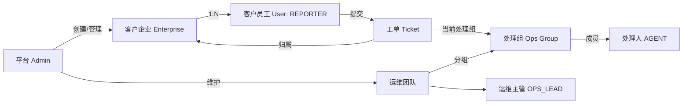
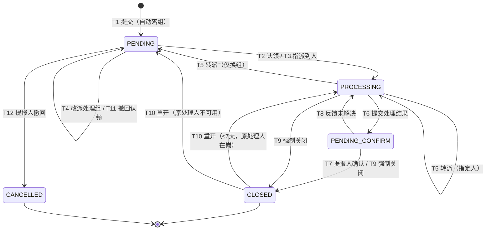
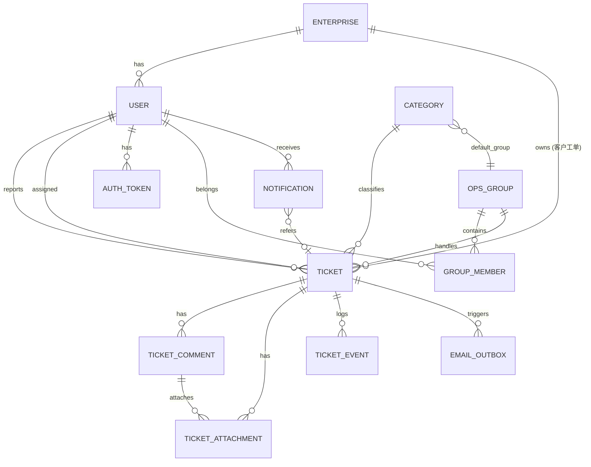

# 运维工单系统（TicketReport）需求文档

| 项目 | 内容 |
| --- | --- |
| 文档版本 | v0.3（已确认） |
| 日期 | 2026-11-25 |
| 状态 | 已确认（Q1=B，其余按默认方案），已进入开发 |
| 阶段 | 第一阶段（MVP）+ 内部工单 / 代客提单 / 运维角色调整 |

---

## 1. 背景与目标

### 1.1 背景

公司运维团队目前通过邮件、电话、即时通讯等零散渠道接收客户报障，存在以下问题：

- 报障信息不完整，缺少分类、优先级、附件，来回沟通成本高；
- 无统一台账，工单归属和处理过程不可追溯；
- 客户之间、客户与运维之间的信息边界依赖人工判断，存在串号与数据泄露风险；
- 处理结果缺少客户确认环节，责任边界不清。

### 1.2 目标

建设一个支持多客户企业、严格数据隔离的内网工单系统，覆盖「客户提交 → 运维受理 → 处理 → 客户确认 → 关闭」的完整闭环，并保留完整评论与操作日志。运维团队自身也可提交内部工单，并可代客户提单；管理员可在运维侧账号间调整角色，调整即时生效并留痕。

### 1.3 成功标准（第一阶段）

1. 客户员工可在 3 分钟内提交一张包含分类、优先级、附件的工单；
2. 工单按分类自动落入默认处理组，组内可认领，主管可改派，全流程状态可追溯；
3. 任意客户账号在任何接口、任何页面都无法获取其他企业的工单、附件、评论、人员数据（有自动化隔离测试覆盖）；
4. 关键节点（提交、受理、待确认、关闭、重开、新评论）均产生站内消息与邮件通知；
5. `docker compose up` 一条命令即可在内网服务器完成部署，无外部依赖。

---

## 2. 范围

### 2.1 第一阶段范围（In Scope）

| 模块 | 内容 |
| --- | --- |
| 组织与账号 | 客户企业创建、客户员工按邮箱邀请、账号启用、禁用、邮箱找回密码；管理员可在运维侧账号间切换角色（处理人 / 运维主管 / 管理员） |
| 工单 | 提交（客户提单 / 内部工单 / 代客户提单）、列表与筛选、详情、编辑（受限）、评论、内部备注、附件 |
| 流转 | 分类自动落组、认领、改派、转派、待确认、关闭、重开、强制关闭、待受理撤回 |
| 通知 | 站内消息中心 + 未读提醒、邮件通知（SMTP 可配置）、通知渠道适配层 |
| 记录 | 工单操作日志（谁在何时做了什么）、管理端操作审计 |
| 报表 | 基础版：工单量、状态分布、分类分布、处理人工作量 |
| 后台 | 客户企业、员工、分类、处理组、系统参数管理 |
| 部署 | Docker 一键启动，SQLite 默认，预留 PostgreSQL 切换 |

### 2.2 明确不做（Out of Scope，第一阶段）

- SLA 计时、超时告警与自动升级；
- 客户满意度评价（CSAT）；
- 知识库 / 常见问题沉淀；
- 复杂分派规则引擎、值班表、轮询分派；
- 高级统计报表、自定义报表、大屏；
- 客户自助注册、客户侧组织架构维护、多级审批；
- 企业微信 / 钉钉等外部渠道的实际对接（仅预留适配层接口）；
- 移动端 App（Web 响应式适配即可）。

---

## 3. 术语

| 术语 | 说明 |
| --- | --- |
| 客户企业（Enterprise） | 使用本系统报障的甲方单位，是数据隔离的边界 |
| 提报人（Reporter） | 提交工单的人。客户员工固定为 `REPORTER` 角色；运维侧账号也可作为提报人（内部工单或代客户提单） |
| 内部工单（Internal Ticket） | 不关联客户企业的工单，仅运维团队可见，不进入客户满意度统计 |
| 代客提单（On-behalf） | 运维侧账号选择某个客户企业代为提交的客户工单，该企业客户可见并可确认，提报人显示为代提人 |
| 运维侧账号 | `AGENT` / `OPS_LEAD` / `ADMIN` 三类内部员工账号 |
| 处理组（Ops Group） | 运维团队内部按分类划分的受理小组 |
| 处理人（Agent） | 运维团队中实际处理工单的成员 |
| 运维主管（Ops Lead） | 可跨组查看、改派、强制关闭的运维管理者 |
| 管理员（Admin） | 平台管理者，负责客户企业、账号、分类与系统配置 |
| 公开评论（Public Comment） | 客户与运维双方可见的沟通记录 |
| 内部备注（Internal Note） | 仅运维侧可见的处理记录，客户不可见 |
| 处理结果（Resolution） | 处理人提交的解决方案说明，触发「待提报人确认」 |

---

## 4. 角色与组织模型

### 4.1 组织模型

- 客户企业是**数据隔离的唯一边界**，工单、附件、评论、通知均继承企业的可见范围。
- 运维团队不隶属于任何客户企业，可跨企业查看与处理。
- 不开放客户自助注册。客户企业与员工账号只能由管理员在后台创建。

### 4.2 角色定义

| 角色代码 | 名称 | 归属 | 说明 |
| --- | --- | --- | --- |
| `REPORTER` | 提报人 | 客户企业 | 客户员工统一角色。可提交客户工单、查看本企业全部工单、公开评论、确认/重开自己提报的工单 |
| `AGENT` | 处理人 | 运维团队 | 认领本组工单、处理、内部备注、转派、提交处理结果；可提交内部工单或代客户提单 |
| `OPS_LEAD` | 运维主管 | 运维团队 | 拥有处理人全部权限，并可跨组查看、改派、强制关闭；可提交内部工单或代客户提单 |
| `ADMIN` | 管理员 | 平台 | 客户企业管理、账号管理（含运维侧角色切换）、分类与处理组维护、系统配置、查看全部数据；可提交内部工单或代客户提单 |

> 说明：第一阶段不设「客户管理员」角色。客户企业内员工权限一致（可见本企业全部工单），仅「确认关闭 / 重开」限定为工单提报人本人（管理员可代为强制关闭）。
> 运维侧账号（`AGENT` / `OPS_LEAD` / `ADMIN`）均可提交工单，并可选择「内部工单」或「代客户提单」。管理员可在管理端将运维侧账号在三类角色之间切换，变更写审计日志并立即生效；客户账号（`REPORTER` 或已绑定企业）不允许跨类转为内部员工，需新建内部账号，历史工单仍留在原企业。

### 4.3 数据隔离原则

1. 客户侧所有查询强制附加 `enterprise_id = 当前登录用户所属企业`，由服务端统一拦截，不依赖前端传参；
2. 客户端任何请求中出现其他企业的资源 ID，一律返回 `404`（不返回 `403`，避免探测资源是否存在）；
3. 附件下载、评论读取、通知列表同样受企业边界约束；
4. 运维角色（`AGENT` / `OPS_LEAD` / `ADMIN`）不受企业边界限制，但仍受「是否为本工单处理组成员 / 主管」的功能权限约束；
5. 隔离逻辑集中在数据访问层 + 守卫（Guard）两层实现，并有自动化测试覆盖绕过尝试；
6. 内部工单 `enterprise_id` 为空，天然不属于任何客户企业，客户侧查询永远无法命中；客户满意度统计只统计客户工单。

---

## 5. 功能需求

### 5.1 客户企业与账号管理

| 编号 | 需求 |
| --- | --- |
| FR-ORG-01 | 管理员可创建客户企业，填写企业名称、简称/编码、联系人、联系电话、备注，创建后企业状态为「启用」 |
| FR-ORG-02 | 管理员可编辑企业信息、停用企业；企业停用后其员工无法登录，历史工单只读保留 |
| FR-ORG-03 | 管理员可按邮箱为某企业添加员工，填写姓名、邮箱；系统生成邀请令牌并发送「注册成功 / 设置密码」邮件，账号状态为「待激活」 |
| FR-ORG-04 | 管理员可重发邀请邮件（使旧链接失效）、禁用员工、修改员工姓名与联系方式 |
| FR-ORG-05 | 员工邮箱在企业内唯一，全平台账号登录标识唯一（同一邮箱不可同时属于两个企业） |
| FR-ORG-06 | 管理员可创建运维账号并指定角色（`AGENT` / `OPS_LEAD` / `ADMIN`）、所属处理组 |
| FR-ORG-07 | 处理组管理：新增、改名、启用/停用、维护成员（组长标记） |
| FR-ORG-08 | 分类管理：新增、改名、排序、启用/停用、绑定默认处理组 |
| FR-ORG-09 | 管理员可在账号管理中将运维侧账号在「处理人 / 运维主管 / 管理员」之间切换，变更立即生效（守卫每次请求从数据库读取角色），并写入审计日志（动作 `USER_ROLE_CHANGE`，记录变更前后角色） |
| FR-ORG-10 | 客户账号（`REPORTER` 或已绑定客户企业的账号）不允许跨类转成内部员工；接口返回明确错误，需新建内部账号，历史工单仍留在原企业 |

### 5.2 认证与找回密码

| 编号 | 需求 |
| --- | --- |
| FR-AUTH-01 | 邮箱 + 密码登录；账号状态为「待激活 / 已禁用」时禁止登录并给出明确提示 |
| FR-AUTH-02 | 邀请链接携带一次性令牌，用户设置密码后账号激活，令牌 72 小时有效、仅可使用一次 |
| FR-AUTH-03 | 忘记密码：输入邮箱，若账号存在则发送重置邮件；无论账号是否存在，接口返回一致提示（防账号枚举） |
| FR-AUTH-04 | 重置令牌 2 小时有效、仅可使用一次；重置成功后使该用户全部会话失效 |
| FR-AUTH-05 | 登录态使用短期访问令牌 + 可轮换的刷新令牌；登出后刷新令牌失效 |
| FR-AUTH-06 | 登录失败次数限制（同一邮箱 5 次/15 分钟），并记录失败日志 |

### 5.3 工单提交

| 编号 | 需求 |
| --- | --- |
| FR-TICKET-01 | 提交字段：标题（必填，5–100 字）、描述（必填，10–5000 字，纯文本保留换行）、分类（必填）、优先级（必填，默认「中」）、附件（可选，最多 5 个） |
| FR-TICKET-02 | 提交后自动生成工单编号，格式 `TK-YYYYMMDD-XXXX`（当日流水），并落入分类绑定的默认处理组，状态为「待受理」 |
| FR-TICKET-03 | 提交成功后：提报人收到「已受理」确认邮件与站内消息；默认处理组内全部处理人收到站内消息 |
| FR-TICKET-04 | 待受理状态下，提报人可编辑标题、描述、分类、优先级、附件；进入处理中后不可再修改主信息 |
| FR-TICKET-08 | 待受理状态下，提报人可撤回工单（二次确认，可选填原因），工单状态变为「已取消」并作废，不再参与待办与处理统计 |
| FR-TICKET-05 | 提报人可查看本企业全部工单（列表、详情、公开评论），并可对任意本企业工单发表公开评论 |
| FR-TICKET-06 | 列表支持：关键词（编号/标题）、状态、分类、优先级、处理人、时间范围筛选，按更新时间倒序，分页 |
| FR-TICKET-07 | 客户侧列表与详情不展示内部备注、内部操作日志、其他处理人信息（仅展示当前处理人姓名） |
| FR-TICKET-09 | 所有人均可提报工单。客户账号提交的工单归属其所属企业，类型为「客户工单」 |
| FR-TICKET-10 | 运维侧账号（`AGENT` / `OPS_LEAD` / `ADMIN`）提交工单时必须选择归属： ①「内部工单」：不挂客户企业（`enterprise_id` 为空），仅运维团队可见，不进入客户满意度统计； ②「代客户提单」：必须选择启用中的客户企业，工单归属该企业，企业内客户可见并可确认，提报人展示为「代提人」并标记「代客户提单」 |
| FR-TICKET-11 | 内部工单没有客户在场：进入「待提报人确认」后，由提报人本人确认关闭 / 反馈未解决 / 重开 / 撤回；运维主管与管理员可强制关闭并填写原因留痕 |
| FR-TICKET-12 | 代客户提单的工单通知：提报人、默认处理组成员，以及该客户企业内全部启用中的客户账号（站内消息）；内部工单不发送客户邮件 |
| FR-TICKET-13 | 工单详情与列表展示工单类型；内部工单企业列显示「内部工单」；代客提单显示「代提」标识与代提人 |

### 5.4 分派与处理

| 编号 | 需求 |
| --- | --- |
| FR-FLOW-01 | 处理人可认领本组「待受理」工单，认领后状态变为「处理中」，处理人为本人 |
| FR-FLOW-02 | 运维主管可将工单改派到任意处理组 / 任意处理人；指派到具体人时状态直接进入「处理中」 |
| FR-FLOW-03 | 处理中工单可转派（组内或跨组），转派必须填写原因；转派后工单进入目标处理组，状态保持「处理中」或回落「待受理」（未指定人时） |
| FR-FLOW-04 | 处理人可写内部备注、上传附件、发表公开评论 |
| FR-FLOW-05 | 处理人提交「处理结果」（必填说明，可选附件）后，工单进入「待提报人确认」，同时邮件通知提报人 |
| FR-FLOW-06 | 同一工单同一时刻只有一个处理人；历史处理人保留在操作日志中 |
| FR-FLOW-07 | 主管与管理员可撤回错误的认领（退回「待受理」） |

### 5.5 评论与内部备注

| 编号 | 需求 |
| --- | --- |
| FR-CMT-01 | 评论分两类：公开评论（双方可见）、内部备注（仅运维可见） |
| FR-CMT-02 | 评论内容纯文本，支持换行与 @提及（第一阶段仅做成员选择器插入姓名，不做通知联动） |
| FR-CMT-03 | 评论按时间正序展示，显示作者、角色、时间；内部备注有明显视觉标识 |
| FR-CMT-04 | 评论提交后不可编辑；作者可在 10 分钟内撤回（软删除，保留操作日志） |
| FR-CMT-05 | 评论可携带附件 |
| FR-CMT-06 | 客户不可见内部备注数量、内容及存在痕迹；服务端对客户角色过滤该字段 |

### 5.6 附件

| 编号 | 需求 |
| --- | --- |
| FR-FILE-01 | 单文件 ≤ 20MB，单工单累计 ≤ 100MB，最多 5 个/次 |
| FR-FILE-02 | 允许类型：图片（png/jpg/jpeg/gif/webp）、文档（pdf/doc/docx/xls/xlsx/ppt/pptx）、文本（txt/log/csv）、压缩包（zip/rar/7z） |
| FR-FILE-03 | 附件存储于本地卷（`/data/uploads`），按企业/工单分层，文件名使用随机 ID，原始文件名入库 |
| FR-FILE-04 | 下载需鉴权并校验企业边界；不支持公开直链 |
| FR-FILE-05 | 删除工单不物理删除附件（保留审计），仅标记工单已删除（第一阶段不做删除工单功能，仅停用企业时保留数据） |

### 5.7 状态流转与确认

| 编号 | 需求 |
| --- | --- |
| FR-STATE-01 | 状态共 5 个：待受理、处理中、待提报人确认、已关闭、已取消，流转严格受状态机约束，非法流转返回明确错误 |
| FR-STATE-02 | 仅提报人本人可点击「确认已解决」关闭工单；同企业其他员工只能查看与评论 |
| FR-STATE-03 | 提报人可「反馈未解决」，工单回到「处理中」，必填原因 |
| FR-STATE-04 | 已关闭工单在 N 天内（默认 7 天，可配置）可由提报人重开，回到「处理中」并保留原处理人；超期不可重开，可新建工单 |
| FR-STATE-05 | 管理员 / 运维主管可强制关闭「处理中」或「待确认」工单，必须填写原因，操作记入日志并通知提报人 |
| FR-STATE-06 | 每次状态变更写入操作日志并触发对应通知 |
| FR-STATE-07 | 仅提报人本人可在「待受理」状态撤回自己的工单；「已取消」为终态，不可重开、不可恢复，已分配的组与处理人自动解除 |

### 5.8 通知

| 编号 | 需求 |
| --- | --- |
| FR-NOTIFY-01 | 站内消息中心：消息列表、未读数、单条已读、全部已读；导航栏红点与数量 |
| FR-NOTIFY-02 | 点击消息可跳转到对应工单 |
| FR-NOTIFY-03 | 邮件通知覆盖：工单提交确认、受理/指派、公开评论、待确认、关闭、重开、邀请与密码重置 |
| FR-NOTIFY-04 | 内部备注不触发客户邮件，只通知该工单相关运维人员（站内） |
| FR-NOTIFY-05 | SMTP 通过配置项提供（host/port/user/password/from/secure）；未配置时邮件写入本地 outbox 表并标记为「未发送（本地）」 |
| FR-NOTIFY-06 | 邮件发送失败自动重试（最多 3 次，指数退避），最终失败记录错误信息，不阻塞业务主流程 |
| FR-NOTIFY-07 | 通知通过统一适配层分发，业务代码不直接调用邮件/站内消息实现；后续接入企业微信只需新增渠道实现 |

### 5.9 操作日志

| 编号 | 需求 |
| --- | --- |
| FR-LOG-01 | 工单操作日志记录：操作类型、操作人、时间、变更前后值（状态、处理组、处理人、优先级）、备注原因 |
| FR-LOG-02 | 工单详情以时间线展示操作日志；客户侧只展示与客户相关的节点（创建、受理、待确认、关闭、重开、公开评论），隐藏内部转派细节与内部备注 |
| FR-LOG-03 | 管理端操作（创建/停用企业、邀请/禁用账号、分类与处理组变更、系统配置修改）写入独立审计日志 |
| FR-LOG-04 | 日志不可修改、不可删除（仅追加） |

### 5.10 基础统计报表

| 编号 | 需求 |
| --- | --- |
| FR-RPT-01 | 概览卡片：工单总数、待受理数、处理中数、待确认数、已关闭数、已取消数、平均处理时长（创建→关闭，不含已取消） |
| FR-RPT-02 | 状态分布、分类分布、优先级分布（图表） |
| FR-RPT-03 | 处理人工作量：按处理人统计当前处理中数量、近 30 天关闭数量 |
| FR-RPT-04 | 时间范围筛选（默认近 30 天）；客户角色仅可查看本企业范围数据，运维可按企业筛选 |

### 5.11 系统设置

| 编号 | 需求 |
| --- | --- |
| FR-SET-01 | 可配置：站点名称、工单重开时限（天）、附件大小上限、是否开启邮件通知 |
| FR-SET-02 | SMTP 配置通过环境变量提供，管理端只读展示「已配置 / 未配置」状态，不在界面回显密码 |
| FR-SET-03 | 配置变更写入审计日志 |

---

## 6. 工单状态机

### 6.1 状态定义

| 状态代码 | 名称 | 含义 |
| --- | --- | --- |
| `PENDING` | 待受理 | 已提交并落入默认处理组，尚无处理人 |
| `PROCESSING` | 处理中 | 已有处理人，正在处理 |
| `PENDING_CONFIRM` | 待提报人确认 | 处理人已提交处理结果，等待客户确认 |
| `CLOSED` | 已关闭 | 客户确认解决、主管/管理员强制关闭 |
| `CANCELLED` | 已取消 | 提报人在待受理阶段主动撤回，工单作废，终态 |

### 6.2 状态流转表

| # | 起始状态 | 触发动作 | 目标状态 | 允许角色 | 附加条件 / 副作用 |
| --- | --- | --- | --- | --- | --- |
| T1 | （无） | 提交工单 | `PENDING` | 任意已登录账号（客户 / 运维侧） | 客户提交归属本企业；运维侧须选择「内部工单」或「代客户提单」；自动落分类默认处理组；通知组内处理人 + 提报人 |
| T2 | `PENDING` | 认领 | `PROCESSING` | 处理人（本组成员） | 记录 assignee、受理时间；通知提报人 |
| T3 | `PENDING` | 指派给具体人 | `PROCESSING` | 运维主管 / 管理员 | 可跨组；记录改派原因；通知新处理人与提报人 |
| T4 | `PENDING` | 改派到其他处理组（不指定人） | `PENDING` | 运维主管 / 管理员 | 更新处理组；通知新组全员 |
| T5 | `PROCESSING` | 转派（指定人 / 仅换组） | `PROCESSING` / `PENDING` | 处理人（本人工单）/ 主管 / 管理员 | 必填转派原因；指定人则保持处理中，仅换组则回落待受理 |
| T6 | `PROCESSING` | 提交处理结果 | `PENDING_CONFIRM` | 当前处理人 / 主管 / 管理员 | 处理说明必填；邮件通知提报人 |
| T7 | `PENDING_CONFIRM` | 确认已解决 | `CLOSED` | 提报人本人（客户工单为客户提报人，内部工单为运维提报人） | 记录关闭时间、关闭人；通知处理人与组内成员 |
| T8 | `PENDING_CONFIRM` | 反馈未解决 | `PROCESSING` | 提报人本人 | 必填原因；通知处理人；处理人不变 |
| T9 | `PENDING_CONFIRM` / `PROCESSING` | 强制关闭 | `CLOSED` | 运维主管 / 管理员 | 必填原因；通知提报人；内部工单不发送客户邮件 |
| T10 | `CLOSED` | 重开 | `PROCESSING` | 提报人本人 | 限关闭后 N 天内（默认 7 天）；处理人为空则回到 `PENDING` 并通知组内 |
| T11 | `PENDING` | 撤回认领 / 取消指派 | `PENDING` | 运维主管 / 管理员 | 清空 assignee，记录日志 |
| T12 | `PENDING` | 撤回工单 | `CANCELLED` | 提报人本人（含运维侧提报的内部工单） | 二次确认，可选填原因；清空处理组与处理人，写入公开操作日志，通知组内成员不再处理 |

> 说明：T10 中若原处理人已禁用或离职，工单回到 `PENDING` 并通知原处理组，由组内重新认领。
> `CANCELLED` 为终态，不参与「待受理/处理中/待确认」待办统计，也不允许重开；客户如需继续跟进应新建工单，系统在详情页给出提示。
> 内部工单没有客户在场，T7 / T8 / T10 / T12 的身份校验为「工单提报人本人」，与角色无关；T9 仍由运维主管 / 管理员执行并留痕。
> 代客户提单的工单没有客户提报人，T7 / T8 / T10 由该客户企业的客户账号执行（企业内任一启用账号），代提人本人不能代替客户确认。

### 6.3 状态图

### 6.4 状态机约束

1. 状态值、流转表在后端以**单一配置源**定义（`ticket-state-machine.ts`），前后端共享枚举，前端按钮可见性由同一份配置推导，避免两端规则漂移；
2. 每次流转在同一数据库事务内完成：更新工单 → 写评论/处理结果 → 写操作日志 → 写通知，保证数据一致；
3. 非法流转（如客户直接改状态、处理人在非本人工单上提交结果）返回 `409/403` 并记录失败审计；
4. 状态变更使用乐观锁（`version` 字段）防止并发认领导致的双处理人；
5. 「撤回工单」必须先校验状态仍为 `PENDING`，与认领并发时以乐观锁结果为准：认领成功则撤回失败并提示刷新。

---

## 7. 权限矩阵

图例：`✅` 允许（受数据范围约束）；`👁` 仅查看；`⚠️` 有条件允许；`❌` 不允许。

| 功能 | 提报人 REPORTER | 处理人 AGENT | 运维主管 OPS_LEAD | 管理员 ADMIN |
| --- | --- | --- | --- | --- |
| 提交工单 | ✅（限本企业，客户工单） | ✅（内部工单 / 代客户提单） | ✅（内部工单 / 代客户提单） | ✅（内部工单 / 代客户提单） |
| 查看工单列表 | ✅ 本企业全部 | ✅ 本组 + 自己相关 | ✅ 全部 | ✅ 全部 |
| 查看工单详情 | ✅ 本企业 | ✅ 本组 + 自己相关 | ✅ 全部 | ✅ 全部 |
| 查看公开评论 | ✅ 本企业 | ✅ 本组 + 自己相关 | ✅ 全部 | ✅ 全部 |
| 查看内部备注 | ❌ | ✅ 仅本组/自己工单 | ✅ 全部 | ✅ 全部 |
| 查看内部操作日志 | ❌（仅客户相关节点） | ✅ 本组/自己工单 | ✅ 全部 | ✅ 全部 |
| 提交工单（编辑主信息） | ⚠️ 仅自己的、待受理 | ⚠️ 仅自己提报的、待受理 | ⚠️ 仅自己提报的、待受理 | ⚠️ 仅自己提报的、待受理 |
| 撤回工单 | ⚠️ 仅自己的、待受理 | ⚠️ 仅自己提报的、待受理 | ⚠️ 仅自己提报的、待受理 | ⚠️ 仅自己提报的、待受理 |
| 发表公开评论 | ✅ 本企业 | ✅ 本组/自己工单 | ✅ 全部 | ✅ 全部 |
| 写内部备注 | ❌ | ✅ 本组/自己工单 | ✅ 全部 | ✅ 全部 |
| 上传附件 | ✅ 自己的工单/评论 | ✅ 本组/自己工单 | ✅ 全部 | ✅ 全部 |
| 下载附件 | ✅ 本企业 | ✅ 本组/自己工单 | ✅ 全部 | ✅ 全部 |
| 认领工单 | ❌ | ✅ 本组待受理 | ✅ 任意待受理 | ✅ 任意待受理 |
| 改派 / 转派 | ❌ | ⚠️ 仅本人处理的工单转到本组 | ✅ 任意 | ✅ 任意 |
| 提交处理结果 | ❌ | ✅ 本人处理中工单 | ✅ 任意处理中 | ✅ 任意处理中 |
| 确认关闭 | ⚠️ 仅本人提报的待确认工单；代提工单由本企业客户账号确认 | ⚠️ 内部工单中本人提报的 | ⚠️ 内部工单中本人提报的 | ⚠️ 内部工单中本人提报的；客户工单可强制关闭（需原因） |
| 反馈未解决 / 重开 | ⚠️ 仅本人提报的工单；代提工单由本企业客户账号执行 | ⚠️ 内部工单中本人提报的 | ⚠️ 内部工单中本人提报的 | ⚠️ 内部工单中本人提报的 |
| 强制关闭 | ❌ | ❌ | ✅ 需原因 | ✅ 需原因 |
| 调整运维侧账号角色 | ❌ | ❌ | ❌ | ✅ 审计留痕、立即生效 |
| 查看通知 | ✅ 仅本人 | ✅ 仅本人 | ✅ 仅本人 | ✅ 仅本人 |
| 查看统计报表 | ✅ 本企业范围 | ✅ 本组/本人 | ✅ 全部 | ✅ 全部 |
| 创建/停用客户企业 | ❌ | ❌ | ❌ | ✅ |
| 邀请/禁用员工账号 | ❌ | ❌ | ❌ | ✅ |
| 维护分类/处理组 | ❌ | ❌ | ⚠️ 可查看 | ✅ 可维护 |
| 系统设置 | ❌ | ❌ | ❌ | ✅ |
| 查看管理审计日志 | ❌ | ❌ | ❌ | ✅ |

**关键权限规则**

1. 「本组」指工单当前 `group_id` 与处理人所属组一致；跨组后原组成员立即失去处理权限，但保留历史评论可见性（只读）。
2. 客户角色永远无法获取 `visibility = INTERNAL` 的任何数据，服务端在序列化层强制剔除，而非仅靠前端隐藏。
3. 任何写操作都要二次校验资源归属（企业边界 + 角色 + 工单当前处理人），不依赖列表页的过滤。
4. 管理员默认拥有全部业务权限，但「确认关闭」「重开」仍以提报人身份为准，管理员走「强制关闭」并留痕，避免替代客户决策。
5. 内部工单 `enterprise_id` 为空，仅运维团队可见；其「确认 / 反馈 / 重开 / 撤回」由提报人本人完成（不要求 `REPORTER` 角色），运维主管与管理员可强制关闭。
6. 代客提单的工单归属所选客户企业，客户侧可见并可确认，提报人展示为代提人；代提人本人不能代替客户执行「确认 / 反馈 / 重开」，代提工单的确认由该客户企业的客户账号完成，运维侧如确需结案走「强制关闭」。
7. 运维侧账号角色切换只允许在 `AGENT` / `OPS_LEAD` / `ADMIN` 之间进行；客户账号不可跨类转换。

---

## 8. 数据模型

### 8.1 ER 图

### 8.2 表结构

> 字段类型以 Prisma 类型标注；SQLite 下 `Json` 以 TEXT 存储、枚举以字符串存储（见实施计划）。

#### enterprise 客户企业

| 字段 | 类型 | 说明 |
| --- | --- | --- |
| id | String @id | UUID |
| name | String | 企业名称，必填 |
| code | String @unique | 企业简码，用于展示与筛选 |
| contact_name | String? | 联系人 |
| contact_phone | String? | 联系电话 |
| status | String | `ACTIVE` / `DISABLED` |
| remark | String? | 备注 |
| created_at / updated_at | DateTime | |

#### user 用户（客户员工 + 运维 + 管理员）

| 字段 | 类型 | 说明 |
| --- | --- | --- |
| id | String @id | UUID |
| enterprise_id | String? | 客户员工必填；运维/管理员为 null |
| email | String @unique | 账号标识，全平台唯一 |
| password_hash | String? | 激活前为 null |
| name | String | 姓名 |
| phone | String? | 手机号 |
| role | String | `REPORTER` / `AGENT` / `OPS_LEAD` / `ADMIN`；运维侧角色可由管理员切换 |
| status | String | `INVITED` / `ACTIVE` / `DISABLED` |
| invited_at / activated_at / last_login_at | DateTime? | |
| created_at / updated_at | DateTime | |

索引：`@@index([enterprise_id, role])`、`@@index([status])`

#### auth_token 一次性令牌

| 字段 | 类型 | 说明 |
| --- | --- | --- |
| id | String @id | |
| user_id | String | 关联 user |
| type | String | `INVITE` / `RESET_PASSWORD` |
| token_hash | String @unique | 仅存哈希，明文只出现在邮件链接 |
| expires_at | DateTime | INVITE 72h，RESET 2h |
| used_at | DateTime? | 使用后置位 |
| created_at | DateTime | |

#### refresh_token 刷新令牌

| 字段 | 类型 | 说明 |
| --- | --- | --- |
| id | String @id | |
| user_id | String | |
| token_hash | String @unique | |
| expires_at | DateTime | 默认 7 天 |
| revoked_at | DateTime? | 登出/改密时撤销 |
| user_agent / ip | String? | 审计用 |

#### ops_group 处理组

| 字段 | 类型 | 说明 |
| --- | --- | --- |
| id / name / description | String | 名称唯一 |
| status | String | `ACTIVE` / `DISABLED` |
| created_at / updated_at | DateTime | |

#### group_member 处理组成员

| 字段 | 类型 | 说明 |
| --- | --- | --- |
| id | String @id | |
| group_id | String | |
| user_id | String | |
| is_lead | Boolean | 是否组长（辅助标识，权限仍以 role 为准） |

约束：`@@unique([group_id, user_id])`

#### category 工单分类

| 字段 | 类型 | 说明 |
| --- | --- | --- |
| id / name | String | 名称唯一 |
| default_group_id | String | 默认处理组，必填 |
| sort | Int | 排序 |
| status | String | `ACTIVE` / `DISABLED`（停用后不可新建工单，历史保留） |

#### ticket 工单

| 字段 | 类型 | 说明 |
| --- | --- | --- |
| id | String @id | UUID（内部） |
| ticket_no | String @unique | 对外编号 `TK-20261125-0001` |
| ticket_type | String @default("CUSTOMER") | `CUSTOMER` 客户工单 / `INTERNAL` 内部工单 |
| enterprise_id | String? | 隔离键，客户工单必填且不可变更；内部工单为空 |
| on_behalf | Boolean @default(false) | 是否运维代客户提单 |
| reporter_id | String | 提报人（客户员工或运维侧提报人） |
| title | String | 5–100 字 |
| description | String | 纯文本 |
| category_id | String | 分类 |
| priority | String | `P1` 紧急 / `P2` 高 / `P3` 中 / `P4` 低 |
| status | String | `PENDING` / `PROCESSING` / `PENDING_CONFIRM` / `CLOSED` / `CANCELLED` |
| group_id | String | 当前处理组 |
| assignee_id | String? | 当前处理人，可空 |
| resolution | String? | 处理结果说明 |
| resolved_at | DateTime? | 提交处理结果时间 |
| confirmed_at | DateTime? | 客户确认时间 |
| closed_at | DateTime? | 关闭时间 |
| closed_by_id | String? | 关闭人 |
| close_reason | String? | 强制关闭 / 未解决反馈原因 |
| cancelled_at | DateTime? | 撤回时间 |
| cancel_reason | String? | 撤回原因（可选） |
| reopen_count | Int @default(0) | 重开次数 |
| version | Int @default(0) | 乐观锁 |
| last_activity_at | DateTime | 列表排序依据 |
| created_at / updated_at | DateTime | |

索引：`@@index([enterprise_id, status, last_activity_at])`、`@@index([group_id, status])`、`@@index([assignee_id, status])`

> 升级说明：`ticket_type` 有默认值 `CUSTOMER`、`enterprise_id` 可空、`on_behalf` 默认 `false`，对已有数据执行 `prisma db push` 即可平滑升级，历史工单自动视为客户工单。

#### ticket_comment 评论 / 内部备注

| 字段 | 类型 | 说明 |
| --- | --- | --- |
| id | String @id | |
| ticket_id | String | |
| author_id | String | |
| visibility | String | `PUBLIC` / `INTERNAL` |
| content | String | 1–5000 字 |
| deleted_at | DateTime? | 10 分钟内撤回，软删除 |
| created_at | DateTime | |

索引：`@@index([ticket_id, created_at])`

#### ticket_attachment 附件

| 字段 | 类型 | 说明 |
| --- | --- | --- |
| id | String @id | |
| ticket_id | String | |
| comment_id | String? | 关联评论，可空（提交工单时直接挂工单） |
| uploader_id | String | |
| original_name | String | 原始文件名 |
| stored_path | String | 相对路径，随机名 |
| mime_type / size | String / Int | |
| created_at | DateTime | |

#### ticket_event 工单操作日志

| 字段 | 类型 | 说明 |
| --- | --- | --- |
| id | String @id | |
| ticket_id | String | |
| actor_id | String | 操作人（系统动作为 null 的保留值） |
| action | String | `CREATE` / `CLAIM` / `ASSIGN` / `TRANSFER` / `COMMENT` / `INTERNAL_NOTE` / `RESOLVE` / `CONFIRM` / `REJECT` / `CLOSE` / `FORCE_CLOSE` / `REOPEN` / `CANCEL` / `EDIT` |
| from_value / to_value | String? | 状态、处理组、处理人等变更前后值 |
| reason | String? | 原因说明 |
| visibility | String | `PUBLIC` / `INTERNAL`，决定客户是否可见 |
| meta | Json? | 扩展信息（如附件 ID 列表） |
| created_at | DateTime | |

#### notification 站内消息

| 字段 | 类型 | 说明 |
| --- | --- | --- |
| id | String @id | |
| user_id | String | 接收人 |
| type | String | `TICKET_CREATED` / `TICKET_ASSIGNED` / `TICKET_COMMENT` / `TICKET_PENDING_CONFIRM` / `TICKET_CLOSED` / `TICKET_REOPENED` / `SYSTEM` |
| title / body | String | 消息内容（不含敏感信息） |
| ticket_id | String? | 跳转目标 |
| read_at | DateTime? | 已读时间 |
| created_at | DateTime | |

索引：`@@index([user_id, read_at])`

#### email_outbox 邮件发件箱

| 字段 | 类型 | 说明 |
| --- | --- | --- |
| id | String @id | |
| ticket_id | String? | 关联工单 |
| to_email / subject / body_html / body_text | String | |
| template | String | 模板标识 |
| status | String | `PENDING` / `SENT` / `FAILED` / `SKIPPED_NO_SMTP` |
| attempts | Int @default(0) | |
| last_error | String? | |
| sent_at | DateTime? | |
| created_at | DateTime | |

#### app_setting 系统参数

| 字段 | 类型 | 说明 |
| --- | --- | --- |
| key | String @id | 如 `reopen_window_days`、`max_attachment_mb` |
| value | String | 字符串存储，读取时按类型解析 |
| updated_by / updated_at | String / DateTime | |

#### audit_log 管理端审计

| 字段 | 类型 | 说明 |
| --- | --- | --- |
| id | String @id | |
| actor_id | String | 管理员 |
| action | String | `ENTERPRISE_CREATE` / `USER_INVITE` / `USER_DISABLE` / `USER_ROLE_CHANGE` / `CATEGORY_UPDATE` / `GROUP_UPDATE` / `SETTING_UPDATE` 等 |
| target_type / target_id | String | 操作对象 |
| detail | Json? | 变更详情（脱敏） |
| created_at | DateTime | |

### 8.3 通用约定

1. 主键统一 UUID（`cuid` 亦可），对外编号单独使用 `ticket_no`；
2. 所有时间存 UTC，展示按浏览器时区（Asia/Shanghai）；
3. 软删除仅用于评论撤回；企业、用户、分类等使用状态字段而非物理删除；
4. `ticket_event` 与 `audit_log` 只追加，不提供更新/删除接口；
5. 金额、评分等第一阶段不涉及，避免过度建模。

---

## 9. 非功能需求

| 类别 | 要求 |
| --- | --- |
| 数据隔离 | 客户侧所有读写强制企业边界，自动化测试覆盖越权访问（含附件直链、消息、报表） |
| 安全 | 密码 bcrypt（cost ≥ 10）或 argon2id；令牌仅存哈希；登录限流；请求体大小限制；文件类型与大小白名单；文件路径不可由客户端拼接；ORM 参数化查询防注入；输出转义防 XSS |
| 性能 | 单企业 5000 工单、全平台 5 万工单规模下，列表首屏 P95 < 1s；附件上传 ≤ 20MB 可正常完成 |
| 可用性 | 单机 Docker 部署，服务异常重启自动恢复；数据库文件挂载持久化，支持每日冷备 |
| 可维护性 | 前后端共享类型与状态机定义；核心流程有单元测试与 E2E；关键路径有结构化日志 |
| 兼容性 | Chrome / Edge 最近两个大版本；内网环境不依赖任何 CDN 与外部服务（字体、图标本地化） |
| 可移植性 | 数据库访问层不出现 SQLite 专有语法，切换 PostgreSQL 只改配置与迁移脚本 |
| 审计 | 工单与管理操作全量留痕，保留期不少于 2 年 |

---

## 10. 验收标准

### 10.1 组织与账号

- [ ] AC-ORG-01 管理员创建企业并添加员工后，员工收到含邀请链接的邮件（SMTP 未配置时可在 outbox 查到），点击链接设置密码后可登录；
- [ ] AC-ORG-02 邀请链接超过 72 小时或已使用，再次打开提示失效并引导联系管理员；
- [ ] AC-ORG-03 同一邮箱重复添加、跨企业添加被拒绝并给出明确提示；
- [ ] AC-ORG-04 企业停用后，该企业员工登录被拒绝，运维仍可查看其历史工单。
- [ ] AC-ORG-05 管理员将运维账号从「处理人」调整为「运维主管」后，该账号下一次请求即可改派 / 强制关闭；再降级为「处理人」后相关入口与接口权限立即收回；审计日志存在 `USER_ROLE_CHANGE`（含变更前后角色）。
- [ ] AC-ORG-06 对客户账号（`REPORTER` 或已绑定企业）调用角色切换接口返回 400，提示需新建内部账号，历史工单仍归属原企业。

### 10.2 认证

- [ ] AC-AUTH-01 忘记密码流程在账号存在/不存在时响应一致，不泄露账号是否注册；
- [ ] AC-AUTH-02 重置密码后旧刷新令牌全部失效，需重新登录；
- [ ] AC-AUTH-03 同一邮箱连续 5 次密码错误后进入限制期。

### 10.3 工单闭环

- [ ] AC-FLOW-01 提交工单后自动生成编号并落入分类默认处理组，状态为「待受理」，组内成员收到站内消息；
- [ ] AC-FLOW-02 组内处理人认领后状态变「处理中」，其他处理人无法再认领（并发下仅一人成功）；
- [ ] AC-FLOW-03 主管可将工单跨组改派给指定人，原组失去处理权限，新处理人收到通知；
- [ ] AC-FLOW-04 处理人提交处理结果后状态为「待确认」，提报人收到邮件与站内消息；
- [ ] AC-FLOW-05 提报人确认后工单关闭并记录关闭时间；非提报人调用确认接口返回 403；
- [ ] AC-FLOW-06 提报人反馈未解决后回到「处理中」，原处理人不变；
- [ ] AC-FLOW-07 关闭后 7 天内可重开，超过 7 天提示不可重开；
- [ ] AC-FLOW-08 主管强制关闭必须填写原因，客户收到通知，日志可见原因；
- [ ] AC-FLOW-09 提报人在「待受理」状态撤回工单后状态为「已取消」，无法再认领、编辑、重开，组内成员收到站内提醒；
- [ ] AC-FLOW-10 非提报人或非「待受理」状态调用撤回接口返回 403/409；撤回与认领并发时只有一方成功。
- [ ] AC-FLOW-11 处理人提交内部工单后 `enterprise_id` 为空、`ticket_type=INTERNAL`；客户账号在列表与详情（含直接访问 ID）均不可见（404）；提报人本人确认后关闭；运维主管 / 管理员可强制关闭并填写原因，操作日志与审计可见原因。
- [ ] AC-FLOW-12 运维侧账号代客户 A 提交工单后，工单归属企业 A，企业 A 客户可见并可确认，提报人显示为「代提人」；企业 B 客户不可见；代提人不能代替客户执行「确认已解决」（403），运维主管 / 管理员可强制关闭。
- [ ] AC-FLOW-13 客户账号提交 `ticketType=INTERNAL` 的请求被拒绝（403）；运维侧提交「代客户提单」未指定企业时返回 400。

### 10.4 评论与附件

- [ ] AC-CMT-01 内部备注在客户侧接口响应中不存在（非前端隐藏），客户搜索/通知中也无痕迹；
- [ ] AC-CMT-02 评论 10 分钟内可撤回，撤回后双方列表均不展示，操作日志保留；
- [ ] AC-FILE-01 超过 20MB 或类型不在白名单的文件被拒绝；
- [ ] AC-FILE-02 客户 A 使用客户 B 的附件 ID 下载返回 404；
- [ ] AC-FILE-03 附件在容器重启后仍可下载（卷持久化）。

### 10.5 隔离与权限

- [ ] AC-ISO-01 客户账号遍历他人企业工单 ID，全部返回 404；
- [ ] AC-ISO-02 客户在列表中只能看到本企业工单，统计报表数据同范围；
- [ ] AC-ISO-03 处理人无法操作非本组、非本人工单（主管除外）；
- [ ] AC-ISO-04 权限矩阵中所有 ❌ 项均有对应接口级测试。

### 10.6 通知

- [ ] AC-NOTIFY-01 未配置 SMTP 时，全部邮件进入 outbox 且状态为 `SKIPPED_NO_SMTP`，业务不受阻塞；
- [ ] AC-NOTIFY-02 配置 SMTP 后，邮件实际发出并状态置为 `SENT`；
- [ ] AC-NOTIFY-03 邮件发送失败重试 3 次后置 `FAILED` 并记录错误，不影响工单流转；
- [ ] AC-NOTIFY-04 站内未读数准确，点击消息跳转对应工单并置为已读；
- [ ] AC-NOTIFY-05 新增一个通知渠道实现（如企业微信 Mock）无需修改业务服务代码，仅注册渠道。

### 10.7 报表与部署

- [ ] AC-RPT-01 报表数值与数据库实际数据一致（含企业筛选）；
- [ ] AC-RPT-02 客户角色无法通过报表接口获取其他企业数据；
- [ ] AC-DEPLOY-01 全新机器执行 `docker compose up -d` 后可完成建库、迁移、初始化管理员并访问登录页；
- [ ] AC-DEPLOY-02 切换 `DATABASE_PROVIDER=postgresql` 并按文档操作后，系统功能与 SQLite 模式一致（重点验证状态流转与报表查询）。

### 10.8 质量门禁

- [ ] 核心状态机与权限守卫单元测试覆盖率 ≥ 80%；
- [ ] 端到端主流程（邀请→登录→提交→认领→处理→确认→关闭→重开）自动化通过；
- [ ] 无高危依赖漏洞（`npm audit` 无 high/critical）。

---

## 11. 待确认事项（评审时请拍板）

| # | 问题 | 当前默认方案 |
| --- | --- | --- |
| Q1 | 待受理阶段客户能否撤回（取消）工单？ | **已确认 B**：支持撤回，新增「已取消」状态并作废（见 5.3 FR-TICKET-08、6.2 T12、7 权限矩阵、10.3 AC-FLOW-09/10） |
| Q2 | 同企业其他员工能否代替提报人确认关闭？ | 不允许，仅提报人本人；管理员可强制关闭 |
| Q3 | 重开时限与次数 | 默认关闭后 7 天内、不限次数，时限可在系统设置调整 |
| Q4 | 附件单文件上限与存储位置 | 单文件 20MB，本地卷 `/data/uploads`，暂不接入对象存储 |
| Q5 | 是否需要工单导出（Excel/CSV）？ | 第一阶段不做，报表仅页面展示 |
| Q6 | 运维主管是否可管理处理组成员？ | 可查看，不开放成员维护（仅管理员可改），避免越权 |
| Q7 | 客户员工离职后其工单如何处理？ | 账号禁用，工单保留原提报人信息，管理员可强制关闭或改由其他员工跟进 |
| Q8 | 邮件模板是否需要中英文双语？ | 第一阶段仅中文，模板集中管理便于后续扩展 |
